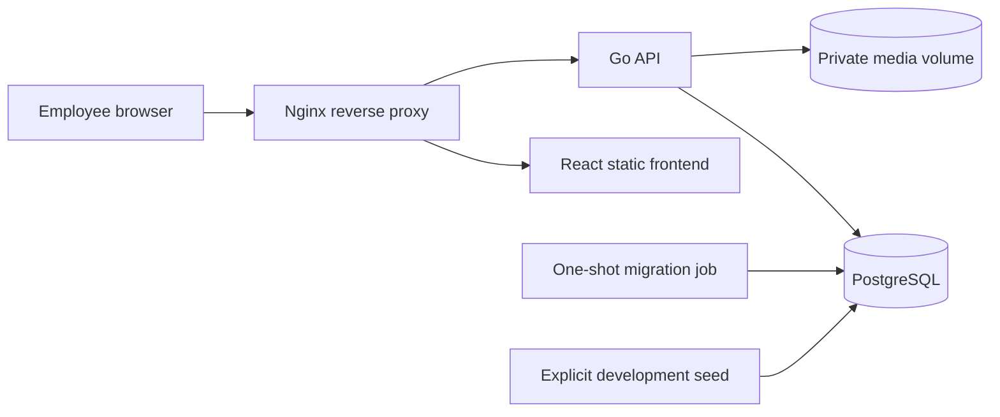

# MedDesk architecture

## Scope and current state

MedDesk is an internal clinic IT help desk and knowledge base. Patient records, private signing keys, certificates, and passwords must never be included in articles, tickets, uploads, or logs. Development uses synthetic data only.

Phases 1–3 are complete and verified. Phase 3 adds persistent knowledge articles/categories/tags, multilingual search, feedback/views, private image/video uploads and delivery, and localized knowledge/editor/category pages. Combined PostgreSQL, live Docker and browser checks passed; see the [delivery report](phase3-report.md). Phase 4 implements ticket suggestions, ownership, comments/screenshots, assignment, status history and draft conversion. Phase 5 adds real staff reporting, administrator audit browsing and clinic settings; see its delivery report for current checks.

## Architecture decision

Use a modular monolith: a Go `net/http` API, PostgreSQL, and a React/TypeScript SPA. Nginx is the single entry point, routing `/api/` to the API and everything else to the frontend. There are no microservices, queues, or Kubernetes requirements.

## Backend boundaries

- `cmd/api`: composition root, constructor injection, signal handling, graceful shutdown.
- `cmd/seed` and `internal/seed`: explicitly development-gated, transactional synthetic account provisioning.
- `internal/config`: validated environment configuration; secrets are never logged.
- `internal/platform`: PostgreSQL pool, sqlc-generated queries, bounded request parsing, consistent responses, and operational handlers.
- `internal/middleware`: request IDs, structured access logs, recovery, request deadlines, security headers, and no-store API responses.
- `internal/auth`: credential verification, opaque sessions, CSRF/origin checks, login rate limiting, and role guard.
- `internal/users` and `internal/departments`: domain DTOs, HTTP handlers, services, and repositories for the implemented account administration flows.
- `internal/knowledge`: article/category/tag HTTP DTOs, validated services, versioned CRUD, PostgreSQL search, visibility and self-service events.
- `internal/media`: streamed multipart handling, validated disk storage, transactional metadata and authorized GET/HEAD/range delivery.
- `tickets` owns current-actor/ownership checks, versioned comments/attachments, staff assignment/status transitions, requester confirmation, administrator reopening and atomic draft conversion. `analytics` uses role-authorized PostgreSQL reporting snapshots; `audit` provides immutable administrator browsing with typed metadata sanitization; `settings` manages safe versioned clinic preferences. Audit writes belong to the transactions producing their events.

Handlers decode requests and translate service results to HTTP. Services validate business rules and coordinate transactions. Repositories execute parameterized sqlc queries using request contexts. Constructor injection and focused interfaces support unit and handler tests without an artificial persistence implementation in production.

All API routes use `/api/v1`. Errors use `{ "error": { "code": "...", "message": "...", "request_id": "..." } }`. Administration lists use bounded pagination and search filters. JSON inputs reject unsupported fields, malformed/non-UTF-8 content, and oversized bodies. Liveness is independent of the database; readiness checks both connectivity and clean migration version 4. Request and database timeouts bound normal operations. Logs contain method, normalized route, status, duration, and request ID, never bodies, cookies, raw query strings, or connection strings.

## Authentication and authorization

Passwords use bcrypt at cost 12. Password validation measures 12–72 UTF-8 bytes, respecting bcrypt's byte limit. Email addresses are normalized before lookup/storage. A failed login never reveals whether an account exists; missing-account comparisons still perform bcrypt work.

Sessions and CSRF secrets each contain 32 cryptographically random bytes encoded for transport. PostgreSQL stores only SHA-256 hashes. Both cookies are `HttpOnly`, `SameSite=Lax`, scoped to `/api/v1`, and expire with the session. Production requires `Secure` cookies; local HTTP development can use `COOKIE_SECURE=false`. The default session lifetime is eight hours, configurable between one minute and 24 hours.

Login requires an exact allowed `Origin`; authenticated mutations require that origin plus the matching session-bound CSRF cookie and `X-CSRF-Token` header. Login and `/auth/me` return the CSRF token to the SPA, which holds it in memory because the cookie is HttpOnly. There is no wildcard CORS policy. The frontend uses same-origin requests, and Vite proxies `/api` during native development. Production configuration requires explicit HTTPS origins and PostgreSQL `sslmode=verify-full`.

The API reads current account role/active status on every protected request. Administrators alone can list/create/update users or departments; any active authenticated user can update only their own display name through `/profile`. There is no self-registration. Frontend route guards and navigation mirror those rules; the API remains the authorization boundary.

Login rotates the presented previous session and removes that user's expired sessions. Logout revokes the current session. Account role, password, email, or activation changes revoke all sessions belonging to that account, including on reactivation. This prevents a previously disabled account's old cookie from becoming usable again. Authentication transactions lock the user before changing sessions and writing audit events; credential state is checked again before issuing a session. Logout uses the same user-before-session lock order to avoid deadlocks with administrator changes.

Login limits are process-local and bounded: 100 attempts per client IP in five minutes and ten attempts per normalized account in 15 minutes, with `Retry-After` responses. Forwarded client addresses are trusted only when the immediate peer matches an explicit non-global `TRUSTED_PROXY_CIDRS` prefix; otherwise the socket peer controls the limit. A restart resets these in-memory windows.

## Administration transactions

User and department mutations share a transaction advisory lock. Services recheck the administrator's current role after acquiring it, lock relevant user/department rows, and commit the mutation with its audit record. Role/password/activation/email changes also revoke sessions in that transaction. An audit failure rolls back the account change.

An administrator cannot demote or deactivate their own account, and the last active administrator is protected. Serializing management mutations prevents two administrators from concurrently removing each other's authority. Active users must belong to an active department. Department deactivation is rejected while it contains active users; administrators first transfer or deactivate them. Accounts and departments are deactivated rather than deleted, preserving historical references.

## Knowledge and self-service

The [knowledge service](../backend/internal/knowledge/service.go) owns validation and authorization; its [repository](../backend/internal/knowledge/repository.go) uses generated queries from [knowledge.sql](../backend/db/queries/knowledge.sql). The API namespace is `/api/v1/knowledge`: article list/create, UUID and optional slug details, versioned update/delete, categories, tags, views and feedback. Article content is plain text with ordered string solution steps, rendered as text by React.

All authenticated roles read published articles whose category is active. The list defaults to `published=true`; engineers/administrators may request `published=false` or `all`, preview drafts and inactive-category content, and create/update/delete articles. Only administrators create/update categories. Deactivation hides a category's articles from employees without deleting history. Staff may retain drafts or unpublish an article in an inactive category; publishing requires an active category. Article DTOs include `category_active` so staff previews suppress public metrics controls.

Knowledge mutations share the administration advisory lock, recheck the current actor, and lock relevant rows before changing content and inserting scrubbed audit metadata in one transaction. Article updates/deletes require the current integer `version`; stale requests return `409 version_conflict`. A linked ticket blocks article deletion, preserving its reference; unpublishing remains available. Tags and ordered image associations change in the article transaction. New media associations require the correct purpose and uploader ownership or administrator authority; another engineer may retain media already attached to the same article.

Search ranks title matches and weighted generated `simple` and `russian` full-text vectors, with case-insensitive tag/substring matching and title word similarity as fallback. The simple configuration preserves Kazakh tokens; no Kazakh stemmer is assumed. Inputs, category/tag filters and pagination are bounded and parameterized. A page obtains ranked IDs then a single batch of detail rows, avoiding a query per article.

Viewing and feedback are explicit CSRF-protected POST operations, independent of read-only article GET. They accept only published articles in active categories. A user's repeat view within 15 minutes does not increase the counter. Feedback carries a client-generated attempt UUID; retrying the same user/article/attempt and answer is a no-op, while changing that attempt's answer returns `409 feedback_conflict`. Later independent attempts remain possible. These events persist for Phase 5 analytics; no support ticket is created in Phase 3.

## Private media

The [media module](../backend/internal/media/) stores bytes in the existing private named volume and metadata in PostgreSQL. Staff upload one multipart `file` to `/api/v1/media?purpose=ARTICLE_IMAGE|ARTICLE_VIDEO`; authentication, role, exact Origin and session CSRF checks run before reading bytes. The whole multipart body and file stream are bounded. Filename/path separators and controls are rejected, while stored keys use random 128-bit names independent of user filenames.

The API accepts PNG/JPEG images up to 10 MiB and MP4/WebM video up to 100 MiB by default. `MEDIA_MAX_VIDEO_BYTES` accepts 1–500 MiB; the frontend currently caps videos at 100 MiB. Database allowance for WebP does not imply an upload API capability: WebP is rejected. Detected bytes must match the declared type, except `application/octet-stream` is allowed. Images are fully decoded after dimensions are bounded to 10,000 per axis and 40 million pixels. MP4/WebM containers are structurally checked for a video track and media content; codec decoding, transcoding, antivirus scanning and universal browser compatibility are not provided.

[FileStore](../backend/internal/media/files.go) anchors operations to an open `os.Root`, uses exclusive private temporary files, verifies regular files and inode identity on open, computes SHA-256 during disk streaming, syncs and renames validated content, then commits metadata/audit. A known failure removes staged/finalized bytes. An ambiguous PostgreSQL COMMIT error retains the private finalized file because the database may have committed; operators must reconcile it rather than risk deleting referenced media. A process crash may also leave temporary or unreferenced files. Automatic orphan/unused-media cleanup and retention remain operational follow-up work; replacing/deleting an article does not delete media bytes or metadata.

Authorized media GET/HEAD use fresh database identity/access checks before conditional or range processing. An uploader or administrator can read their available media; other engineers can read article-attached media; any authenticated role can read media attached to a published article in an active category. Unauthorized/nonexistent IDs return 404. Downloads support byte ranges through `http.ServeContent`, with `private, no-store`, `Vary: Cookie` and `nosniff`; Nginx has no static media alias.

[RouterWithMedia](../backend/internal/platform/health/handler.go) gives uploads and downloads separate non-buffered connection/context deadlines: two minutes and five minutes by default, configurable to ten and 30 minutes respectively. Normal JSON handlers retain their bounded timeout wrapper. The [Nginx media location](../infra/nginx/default.conf) disables request/response buffering and allows the configured API maximum plus multipart overhead; the API enforces the actual limit. Streaming I/O timeout terminates delivery instead of appending a JSON envelope to already-sent bytes.

Phase 4 enforces ticket ownership in SQL and transactions, hides internal comments from employees, restricts screenshot associations by purpose/uploader and permits downloads only to authorized requesters/staff. Assignment and status changes require staff and current versions. The shared management advisory lock precedes user/ticket row locks so role/account changes serialize with mutations. Closed tickets require explicit administrator reopening. Conversion creates an unpublished article and links it to a resolved/closed ticket in one audited transaction.

## Frontend

React, TypeScript, Vite, Tailwind, local shadcn/ui primitives, React Router, TanStack Query, React Hook Form, Zod, Fetch, and Lucide provide the interface. Kazakh is the default locale; Russian is selectable and persisted. Implemented pages include `/login`, `/` (authenticated overview and operational status), `/profile`, `/admin/users`, `/admin/departments`, `/knowledge`, `/search`, `/knowledge/articles/:id`, staff `/engineer/knowledge` with create/edit routes, and administrator `/admin/categories`. See [App.tsx](../frontend/src/App.tsx) for the exact route tree.

The responsive sidebar/top bar exposes role-appropriate navigation. Administration pages have real filtered/paginated tables, loading/error/empty states, bounded forms, toasts, and confirmations for sensitive changes. Dialogs trap focus and restore the opener. Knowledge pages display actual persisted content and search results. Ticket pages implement suggestion-first creation, real lists/details, discussion/history and role-specific actions. Analytics, audit and settings pages use real APIs and role gates; daily charts include accessible table alternatives. Employee dashboards use own-ticket API totals.

The SPA bootstraps identity through `/auth/me`, refreshes on focus and periodically, and clears private query caches on logout, expired authentication, and account/role changes. CSRF secrets remain in memory. Profile forms remount when account identity changes, and late responses from another account cannot overwrite the current identity. Article editors keep their initial editing version when background queries refresh; a conflict preserves unsaved input and requires review of the current article.

## Operations and verification

Pinned dependency lock files, multi-stage non-root application images, health checks, an explicit migration job, and named database/media volumes provide reproducible local deployment. The development gateway binds to loopback by default. Schema and sqlc output are kept together. Phase 2 used migration 1; [migration 2](../backend/db/migrations/000002_knowledge_version.up.sql) adds article optimistic versions and the view-deduplication index, Phase 4 migration 3 adds a single draft-conversion reference per ticket; Phase 5 migration 4 adds settings and an analytics index; current readiness expects version 4.

`make demo-env` generates missing random development password variables in the ignored local environment file without printing them. `make seed-accounts` builds the backend seed executable and runs it explicitly. The seed requires `APP_ENV=development`, provisions all three synthetic roles plus three safe troubleshooting guides atomically, and preserves existing passwords, roles, activation states, article content, publication states and counters. Production and test environments reject demo provisioning.

CI and local verification use Go race tests/vet, frontend type checks/component tests/build, disposable PostgreSQL integration tests, sqlc regeneration, and Compose validation. The PostgreSQL integration runner applies migrations, exercises real repository and HTTP authentication/administration/knowledge/media workflows, checks reference-seed idempotency, performs down/up on the disposable database, and repeats the tests. Both complete Phase 3 PostgreSQL repeats passed, along with Go race/vet, 56 frontend tests/type/build, generation consistency, live gateway/media and localized browser checks. See the [delivery report](phase3-report.md) for fixes and verification limits. Phase 5 verifies the composed self-service-to-ticket-to-guide/reporting workflow; current limits are in the Phase 5 report and operations document.

Production deployment still requires clinic HTTPS ingress, managed secrets, account lifecycle decisions, separate migration/runtime database privileges, backup/restore drills, and retention policy. Upload scanning, media retention/orphan reconciliation, storage quotas and recovery policy remain clinic deployment decisions. Local Compose is a development deployment, not production certification.

## Private school module

The school module is an isolated owner-only workspace inside the modular monolith. Explicit database ownership, rather than clinic RBAC, protects dedicated assets, tickets and history. School history stays out of clinic audit exports. Account administration protects the private owner against another clinic administrator resetting that account. See [school workspace boundaries and deployment](school-workspace.md).
